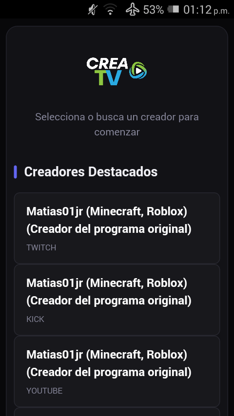
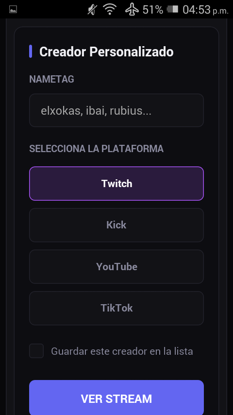
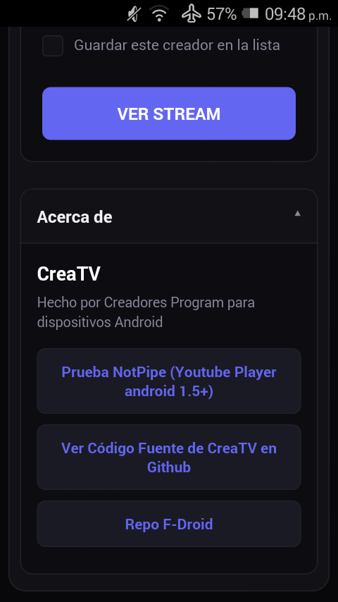
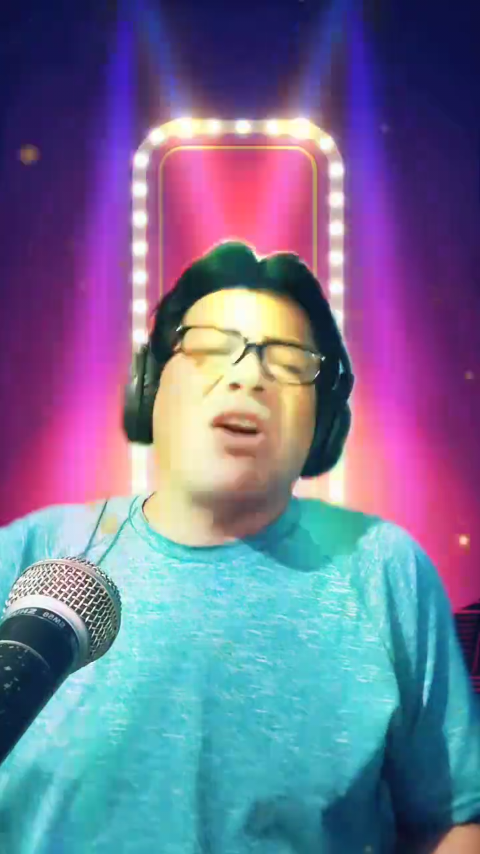
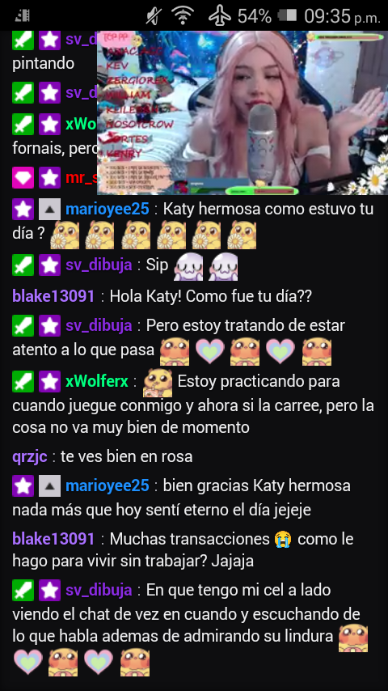
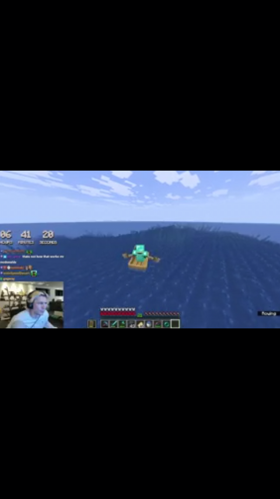
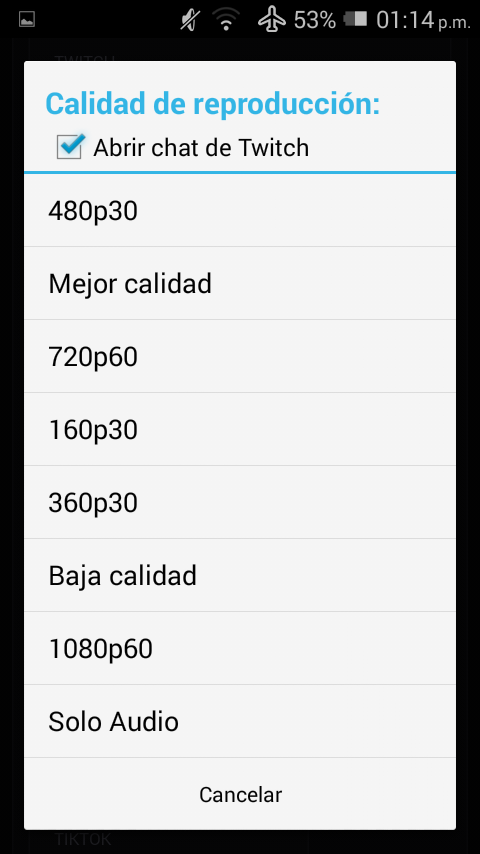

# 📺 CreaTV

**If you don't speak Spanish, go to the [Wiki](./wiki).**

**CreaTV** es un cliente no oficial de plataformas de *streaming* diseñado específicamente para dispositivos **Android 2.3 a Android 10**. Permite acceder y reproducir transmisiones en vivo de manera ligera y optimizada.

---

## 🚀 Características y Compatibilidad

CreaTV ofrece soporte para las plataformas de streaming más populares:

- 🟣 **Twitch**
- 🟢 **Kick**
- 🖤 **TikTok Live**
- 🔴 **YouTube Live**

---

## ⚙️ Requisitos del Sistema

- **Sistema Operativo:** Android 2.3 (Gingerbread) hasta Android 10 (Quince Tart).
- **Reproductor de Video Externo:** Es **indispensable** contar con un reproductor de video instalado en el dispositivo para la reproducción de los streams.

---

## 🧪 Pruebas y Reproductores Recomendados

- ❌ **Google Fotos:** Es probable que falle o presente incompatibilidad al reproducir transmisiones en versiones antiguas de Android.
- ✅ **VLC Player (Recomendado para Android 4.0+):** Se recomienda encarecidamente utilizar **VLC Player**, ya que ofrece mayor estabilidad, compatibilidad con formatos de red y funciones avanzadas como Picture-in-Picture (PiP).
> [!WARNING]
> Presenta cierres inesperados (crashes) en **Android 2.3 a 3.2**
- ✅ **MX Player (Recomendado para Android 2.3–3.2):** Funciona correctamente y sin fallos en versiones legacy donde VLC genera problemas.

---

## 💬 Función de Chat

Actualmente, el servicio de chat en vivo **solo está soportado para Twitch**.

### ¿Cómo usar el chat en vivo?
1. Marca la casilla correspondiente al chat dentro de la aplicación **CreaTV**.
2. Al abrir el stream, abre el reproductor de video (ej. VLC Player) y presiona la opción de **Minimizar / Picture-in-Picture (PiP)**.
3. El reproductor quedará en una pequeña ventana flotante y en el fondo podrás visualizar y utilizar el chat en tiempo real.

---

## ⚠️ Inconvenientes Conocidos y Notas Técnicas

### Proxy TLS 1.2 / 1.3 (Android 2.3 - 3.3)
- El soporte mediante proxy **TLS 1.2/1.3** para **Android 2.3 a 3.3** se encuentra actualmente en **fase experimental**, por lo que se pueden presentar fallos de conexión o inestabilidad al conectar con servidores modernos.

## **Capturas de Pantalla**
| Capturas | Capturas | Capturas |
|----------|----------|----------|
|  |  |  |
|  |  |  |
|  | 

---

## 🎨 Créditos

- **Diseño del Logotipo:** zManuReal_
- **Reescritura de [Streamlink](https://github.com/streamlink/streamlink) a Java:** Google AI Studio

---

## 📄 Licencia y Descargo de Responsabilidad

* **Disclaimer:** CreaTV es un cliente no oficial y no está afiliado, patrocinado ni respaldado por Twitch, Kick, TikTok o YouTube/Google.